# Agent Architect · Agent 架构研究所

**从原理到架构，从架构到生产。**

**Explore the Architecture of Intelligent Agents.**

Agent Architect 是一个长期维护的中文 Agent 技术知识平台。第二轮升级后，网站从“Agent 架构设计知识网站”扩展为覆盖 **Agent 全生命周期、核心技术体系、工程实践、开发框架、应用场景、生产环境、研究论文与未来演进** 的系统知识库。

核心理念：Agent 工程的难点不只是让模型调用工具，而是设计一个能够可靠感知、规划、执行、记忆、协作、恢复、治理和持续运行的系统。

---

## 第二轮升级概览

第二轮不是重写项目，而是在第一轮成熟组件基础上扩展知识体系和内容架构：

- 建立 **16 个一级知识领域** 与 **58 项指定主题** 的完整覆盖矩阵。
- 新增专题详情页，每个主题具备概览、核心问题、技术路线、学习路径、关联内容、参考资料和真实状态。
- 升级架构决策工具：14 个工程条件、可解释输出、安全/评测/风险建议、Markdown 导出。
- 升级知识图谱：本地 JSON 数据，37 个节点、31 条关系、15 种节点类型、12 种关系类型，支持筛选、搜索与节点详情。
- 新增 30 张原创 SVG，累计 55 张架构图。
- 新增 Agent Project Blueprint：10 类工程项目模板。
- 新增开源项目中心与论文研究中心。
- 深度重写第二轮 17 篇与主题补完 11 篇共 **28 篇文章**：每篇包含真实事故场景、可运行代码、结构化数据模型、对照表、失败模式与落地清单，充分利用 Markdown 渲染器的代码块、表格、引用与目录能力，不再停留在提纲式段落。
- 修复全站路由 404：静态领域路由正确解析栏目，未知路径安全回退到领域页或首页。
- 保留原有搜索、收藏、导航、文章、模式、架构图、Markdown 阅读器、代码块、SEO 与 GitHub Pages 部署。

## 16 个一级知识领域

1. Agent Engineering · AI Agent 工程实践
2. Agent Architecture · Agent 架构设计
3. Multi-Agent Systems · 多智能体系统
4. Agent Workflow · 工作流与编排
5. Agent Frameworks · Agent 开发框架深度解析
6. Agent Protocols · MCP/A2A 协议与互操作
7. Agent Core Mechanisms · 核心机制
8. Agent Memory & Context · 记忆与上下文
9. Agent Runtime & Infrastructure · 运行时与基础设施
10. Agent Security & Governance · 安全与治理
11. Agent Evaluation & Reliability · 评测与可靠性
12. Agent Production · 生产环境工程
13. Agent Applications · 应用领域
14. Agent Research · 开源项目、论文与前沿研究
15. Agent Product & Business · 产品与商业化
16. Future of Agents · 未来演进

完整主题清单见 `src/data/topic-catalog.ts`，可视化矩阵见网站 `/topic-catalog` 页面。

## 网站功能

- 独立首页、深色 Hero 与原创 SVG 架构主图。
- 16 个一级知识领域页面，包含二级专题、深度文章与结构化入口。
- 58 项主题覆盖矩阵，支持按领域、状态筛选和缺口识别。
- 59 篇文章，覆盖原理、架构、核心机制、工程实践、应用与未来方向。
- 25 个设计模式，包含控制权、状态要求、反模式、伪代码与工程代价。
- 6 个参考架构方案，逐项说明模块职责、依赖、控制流、数据流、状态流、失败模式和权衡。
- 55 张原创 SVG 架构图，统一图例，区分概念模型、参考架构与特定实现。
- 16 个开源项目分析索引，按框架、多 Agent、Coding、Browser、Runtime、协议等分类。
- 18 篇论文解读，优先引用 arXiv、会议与官方资料；结果以原文为准。
- 6 本技术书籍导读。
- 10 类 Agent 项目工程蓝图。
- 架构决策工具 V2：14 个条件、11 类输出、可导出 Markdown 决策记录。
- 知识图谱 V2：本地 JSON、节点/关系筛选、搜索与详情。
- 全站搜索（`Ctrl/Cmd + K`）、栏目筛选、标签筛选、难度筛选、内容类型筛选。
- 收藏、阅读清单、文章目录、阅读进度、代码高亮与复制、图表放大查看。
- SEO：独立 title、meta description、canonical、Open Graph、Twitter Card、sitemap.xml、robots.txt、favicon、结构化数据。
- PC、平板和手机响应式布局；运行时无外部图片依赖。

## 网页截图

以下截图均由本地生产预览服务通过真实浏览器渲染生成，不是设计稿。

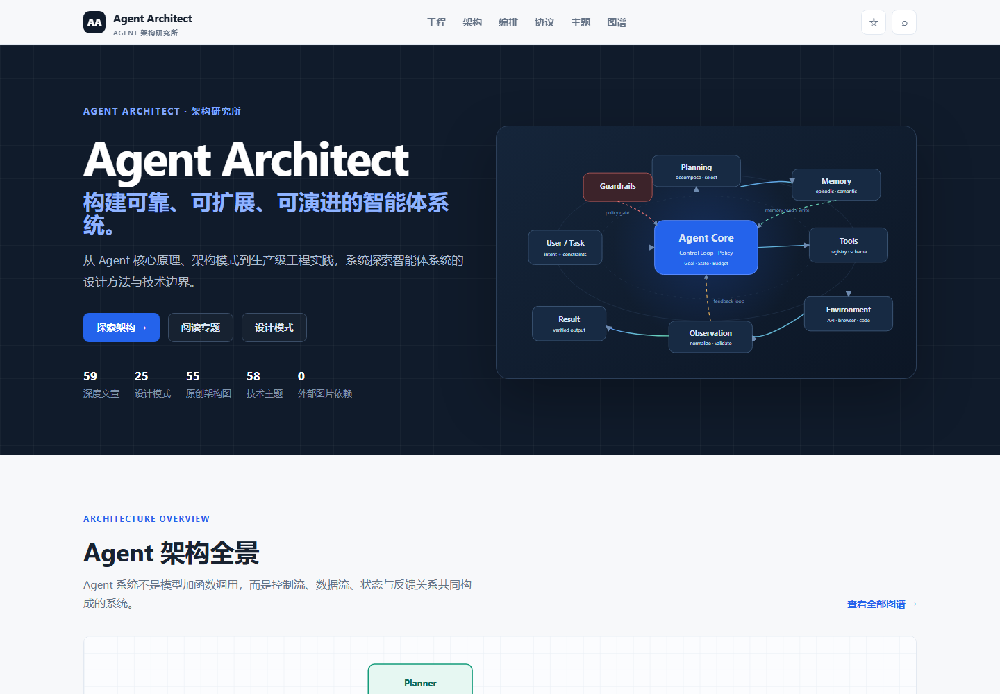

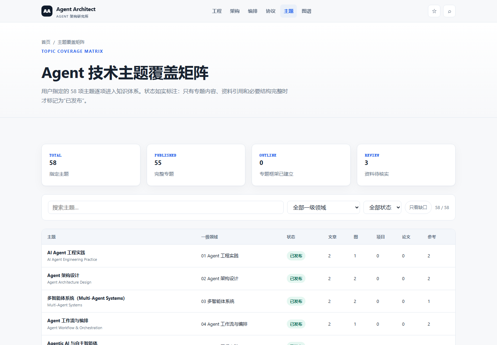

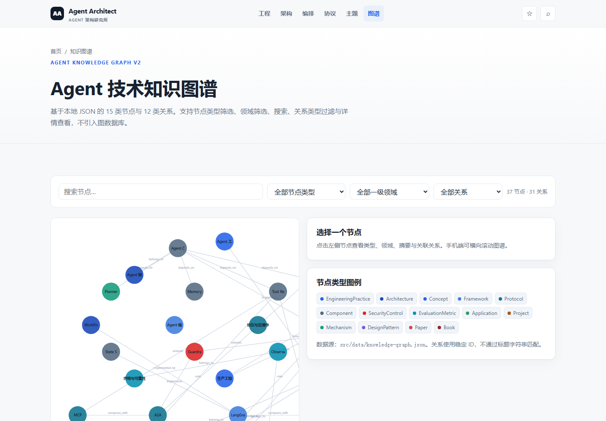

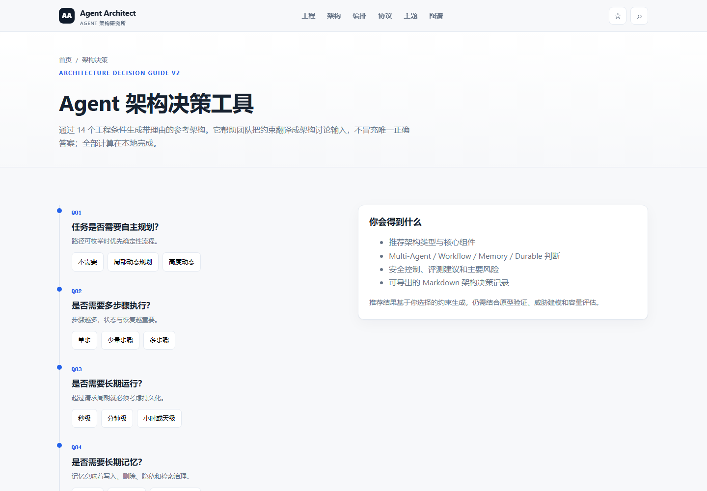

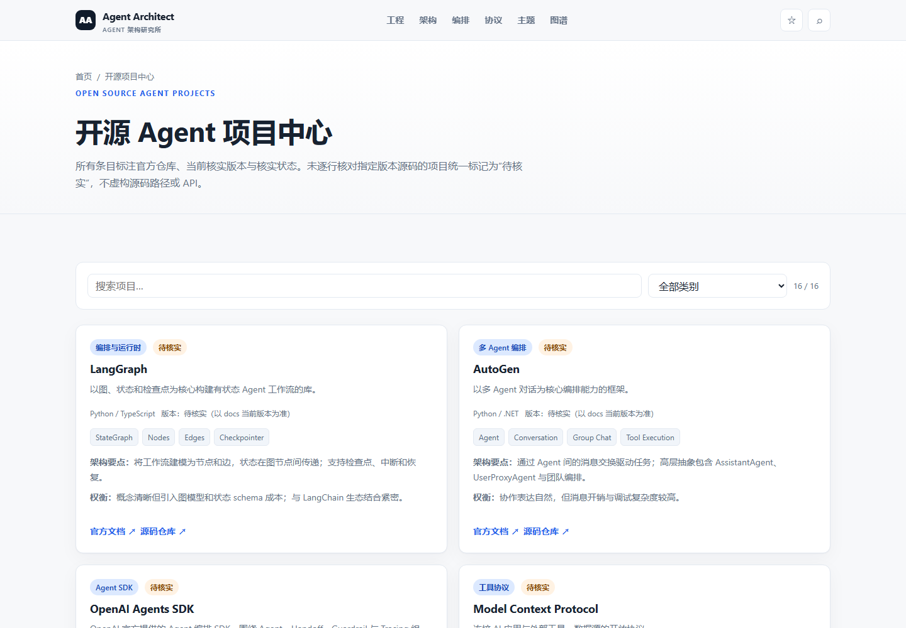

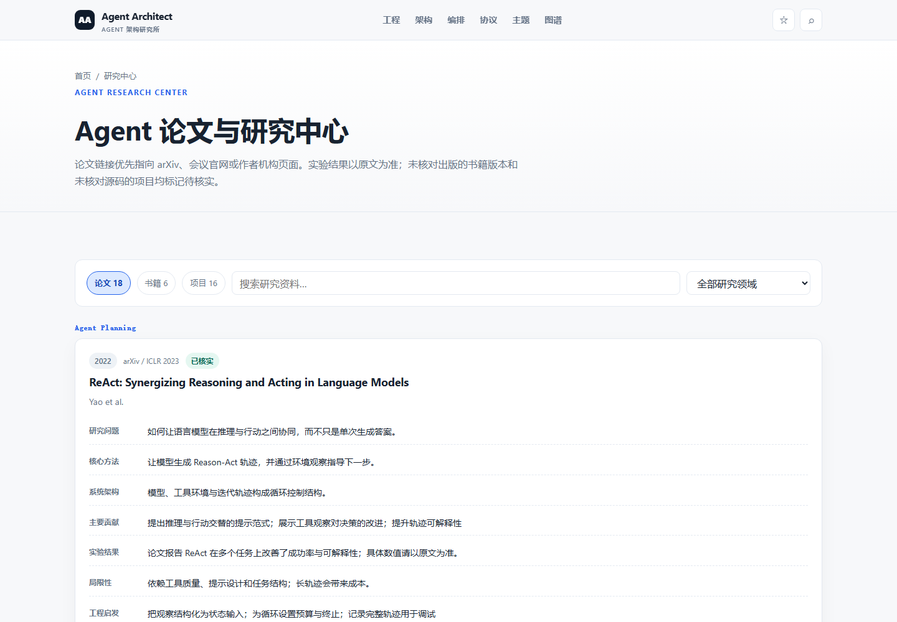

第一轮截图仍保留：

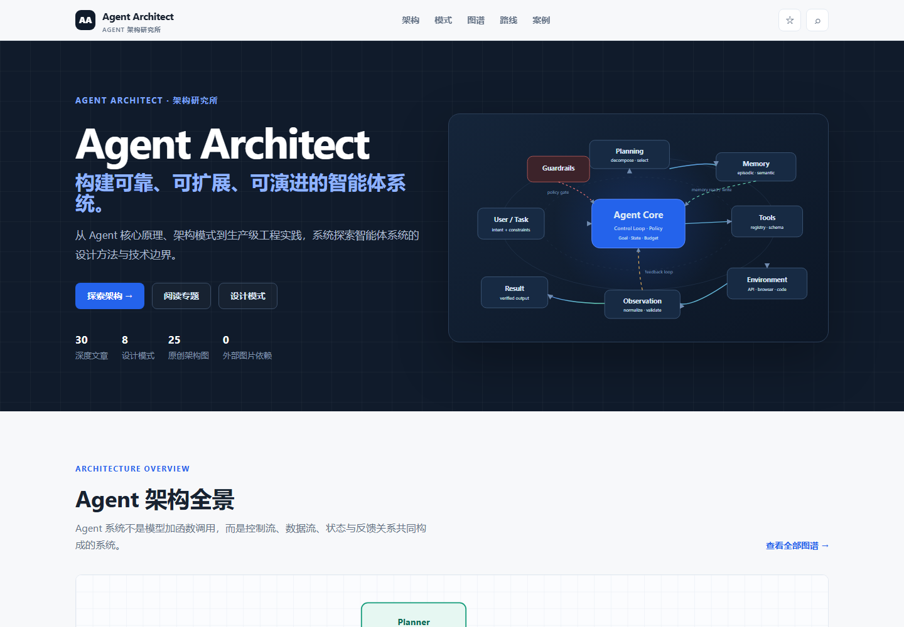

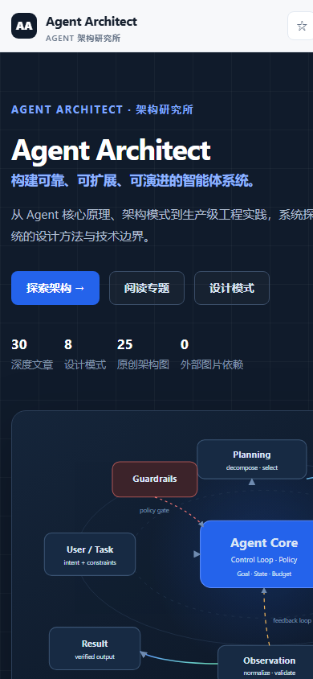

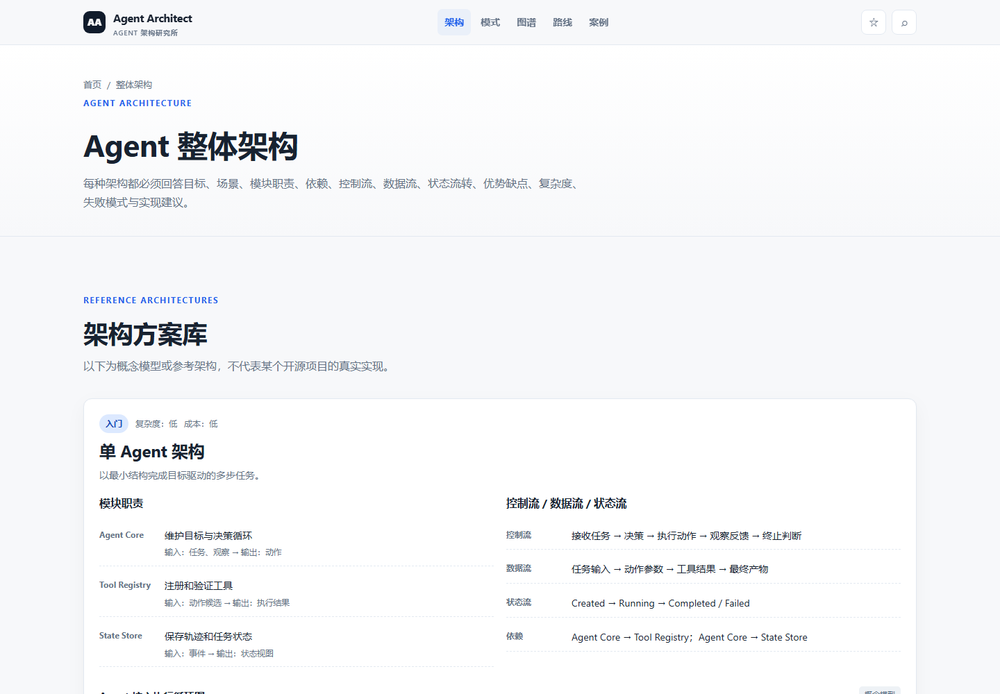

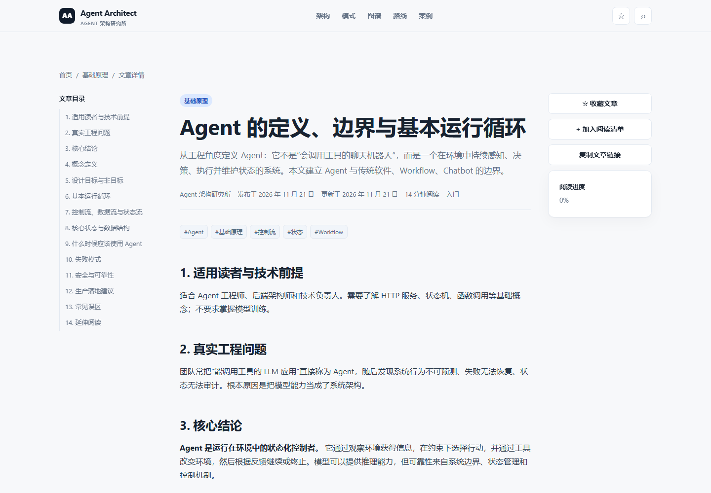

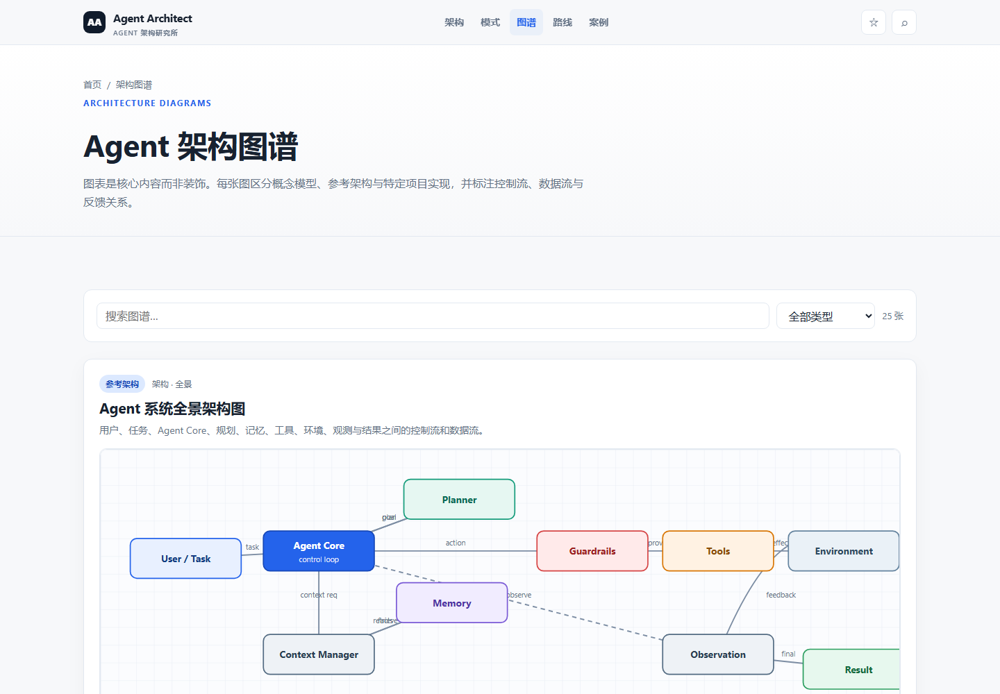

## 技术栈

- Vite 5
- React 18
- TypeScript 5
- React Router 6（HashRouter，适配 GitHub Pages 子路径与静态刷新）
- 原生 CSS，无 UI 组件库
- 原生 SVG，无图表库
- 本地 TypeScript / JSON 内容模块，无运行时后端

生产依赖未增加：`react`、`react-dom`、`react-router-dom`。第二轮没有安装大型 UI 库、图数据库、状态管理库或图表库。

## 主要架构

```text
src/
  components/
    common/          卡片、代码块
    diagrams/        55 张原创 SVG、Hero 主图、放大查看
    layout/          Header、Footer、搜索、收藏面板
  content/
    articles/        59 篇文章，含第一轮 30 篇、第二轮 18 篇与主题补完 11 篇
    architectures/   参考架构数据
    patterns/        25 个设计模式
    projects/        16 个开源项目
    books/           技术书籍数据
    papers/          18 篇论文解读
  data/
    navigation.ts    旧栏目、16 领域、工具导航
    domains.ts       16 个一级知识领域与 SEO 元信息
    topic-catalog.ts 58 项主题覆盖矩阵
    diagrams*.ts     架构图元数据与图数据
    knowledge-graph.json 本地知识图谱
    blueprints.ts    10 类项目工程模板
  hooks/             标题、阅读进度
  lib/               Markdown 渲染、存储、高亮、工具函数
  pages/             首页、领域页、专题页、文章页、研究中心等
  styles/            品牌系统与响应式样式
public/
  images/            本地视觉资源与来源清单
  favicon.svg
  robots.txt
  sitemap.xml
.github/workflows/
  deploy.yml         GitHub Pages 自动部署
docs/screenshots/     真实网页截图
```

内容与 UI 分离：文章、模式、架构、项目、书籍、论文、主题、图谱与蓝图均有独立数据类型；关联使用稳定 ID，不通过标题字符串临时匹配。

## 本地安装与运行

```powershell
cd c:/Users/yxu7szh/YuxinRun/agent-architect
npm install
npm run dev
```

开发服务器默认地址：<http://localhost:5173/>

类型检查、测试与生产构建：

```powershell
npm run typecheck
npm run build
npm run preview
```

预览生产构建：

```powershell
npm run preview -- --host 127.0.0.1 --port 4173
```

## GitHub Pages 部署

1. 将项目推送到 GitHub 仓库 `agent-architect` 的 `main` 或 `master` 分支。
2. 在仓库 Settings → Pages → Build and deployment 中，Source 选择 **GitHub Actions**。
3. 推送后 `.github/workflows/deploy.yml` 自动执行 `npm ci`、`npm run build` 并发布 `dist/`。
4. 访问 `https://<用户名>.github.io/agent-architect/`。
5. 若绑定自定义域名，添加 `CNAME` 并更新 `index.html` 与 `sitemap.xml` 中的域名。

配置说明：

- `vite.config.ts` 使用 `base: './'`，资源使用相对路径。
- 路由使用 `HashRouter`，解决 GitHub Pages 静态刷新 404。
- 新增专题、开源中心、研究中心等路由均处于同一 HashRouter 体系。
- 所有 SVG、favicon、sitemap、robots 均来自本地资源。

## 内容贡献方式

1. 新文章放在 `src/content/articles/`，遵循 `Article` 类型。
2. 新主题加入 `src/data/topic-catalog.ts`，使用稳定 ID 与真实关联。
3. 新模式、架构、项目、书籍、论文分别放入对应内容目录。
4. 新增架构图同时更新 `src/data/diagrams*.ts` 与图数据。
5. 专题状态不能虚标：只有专题内容、关联资料与结构完整时才使用 `published`。
6. 修改后运行 `npm run typecheck` 与 `npm run build`。

## 图片版权与来源

见 `public/images/SOURCES.md`。运行时图片和视觉资产全部为本地文件或原创 SVG，不使用远程图片 CDN。

## 资料核实规范

优先级：官方文档 → 官方 GitHub 仓库与源码 → 原始论文 → 研究机构和会议论文集 → 作者技术文章 → 有技术深度的社区资料。

明确区分：

- 概念模型、参考架构与特定项目实现。
- 模型内部推理过程与系统外部可观测行为。
- Memory、Conversation History、Context、State Store、Knowledge Base。
- 已核实资料与待核实资料。
- 已有工程能力、实验性研究与未来假设。

开源项目分析中，未逐行核对指定版本源码的条目标记为 `to-verify`；论文实验结果不抄录未经核对的数值，统一提示以原文为准。

## 路线图与未完成项

已完成：

- 16 个一级知识领域与 58 项主题覆盖矩阵。
- 59 篇文章、25 个模式、6 个架构、16 个项目、18 篇论文、6 本书、55 张图谱。
- 58 项主题中 55 项已发布，3 项待核实，0 项停留在框架状态。
- 专题页、项目蓝图、知识图谱 V2、决策工具 V2、开源中心、研究中心。
- GitHub Pages、SEO、真实截图。

需继续完善：

- 12 个原框架主题已补齐为发布状态，包含深度文章、架构图与参考资料。
- 3 个主题标记为 `needs-review`，需人工核实资料后再发布。
- 开源项目源码分析尚未完成指定版本的逐行核对，统一为待核实。
- 书籍数量仍低于长期目标 20 本。
- 部分论文实验结果未逐项抄录数值，发布前应回到原文核对。

第二轮尚未完成的主题清单可在网站 `/topic-catalog` 中使用“只看缺口”筛选查看。
